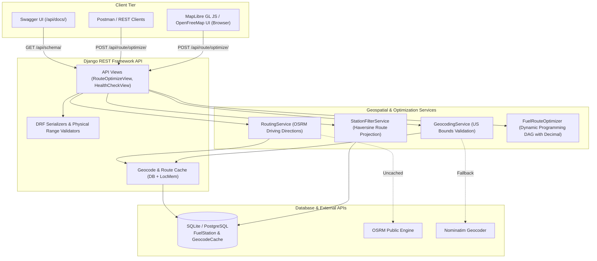

# Fuel Route Optimizer API ⛽🗺️

[](https://www.python.org/)
[](https://www.djangoproject.com/)
[](https://www.django-rest-framework.org/)
[](http://localhost:8000/api/docs/)
[](https://pytest.org/)

A functional REST API and interactive map dashboard that calculates a cost-effective sequence of fuel stops for commercial vehicles driving between any two locations in the continental United States, optimizing over candidate stations along the route corridor under the stated assumptions.

---

## Table of Contents
1. [Project Overview](#1-project-overview)
2. [Vehicle Constraints & Refuelling Assumptions](#2-vehicle-constraints--refuelling-assumptions)
3. [System Architecture](#3-system-architecture)
4. [Core Optimization Algorithm (Dynamic Programming)](#4-core-optimization-algorithm)
5. [Data Ingestion & Coordinate Accuracy](#5-data-ingestion--coordinate-accuracy)
6. [Interactive Map Frontend](#6-interactive-map-frontend)
7. [API Endpoints & Documentation](#7-api-endpoints--documentation)
8. [Setup & Installation Guide](#8-setup--installation-guide)
9. [Automated Testing Suite](#9-automated-testing-suite)
10. [Engineering Decisions & Limitations](#10-engineering-decisions--limitations)
11. [Demonstration Walkthrough Script](#11-demonstration-walkthrough-script)

---

## 1. Project Overview

Long-haul freight transport requires balancing driving range limits against fluctuating retail fuel prices. A driver who stops whenever the fuel gauge is low or blindly selects the nearest cheap station can be forced into an expensive refuel later to prevent running empty.

The **Fuel Route Optimizer** provides an automated planning solution:
- Accepts **any origin and destination** within the continental United States.
- Retrieves road driving directions and polyline geometries via the **Open Source Routing Machine (OSRM)**.
- Identifies candidate stations along the highway corridor from a database of **6,626 validated US fuel stations**.
- Applies a **Directed Acyclic Graph (DAG) Dynamic Programming** algorithm using exact Python `Decimal` arithmetic to select the minimum-cost sequence of fuel stops respecting the vehicle's 500-mile range.
- Serves an interactive **MapLibre GL JS** map dashboard, OpenAPI 3.0 documentation, and a Postman test suite.

---

## 2. Vehicle Constraints & Refuelling Assumptions

Vehicle and search parameters are configurable via the API:

| Parameter | Default Value | Description |
| :--- | :--- | :--- |
| **Max Range** | `500.0` miles | Maximum distance the vehicle can travel on a full tank before refuelling is mandatory. |
| **Fuel Economy** | `10.0` MPG | Vehicle efficiency in miles per gallon. Fuel consumed per mile = `1 / MPG`. |
| **Tank Capacity** | `50.0` gallons | Maximum fuel capacity. Physical constraint: $\text{Max Range} \le \text{Tank Capacity} \times \text{MPG}$. |
| **Corridor Radius** | `5.0` miles | Lateral cross-track search radius on either side of the highway route. |
| **Origin Refuel Radius** | `25.0` miles | Straight-line radius around origin to identify the pre-trip refuelling price source. |

### Pre-Trip Refuelling Assumption
- The vehicle is assumed to refuel before starting the journey at the cheapest station located within a 25.0-mile straight-line radius of the origin.
- The retail price at this station is applied to fuel the initial route leg starting at route mile zero.
- Station-access detour distance is excluded from the driving route distance and fuel expenditure calculations.
- This is a pricing assumption for the starting point; it is not a physically simulated empty-tank detour.
- If no eligible station exists within 25.0 miles of the origin, the optimizer returns an informative HTTP 422 error.

---

## 3. System Architecture



---

## 4. Core Optimization Algorithm

### Dynamic Programming vs. Greedy Selection
A greedy strategy selects the cheapest station reachable from the current location. This can lead to a suboptimal outcome where the vehicle is subsequently forced into an expensive station to avoid running out of fuel.

Consider this counterexample:
- **Origin:** Mile 0 (Pre-trip fuel price: \$3.50/gal)
- **Station 1 (Locally Cheap):** Mile 100 (Price: **\$2.00/gal**)
- **Station 2 (Forced Expensive Stop):** Mile 590 (Price: **\$5.00/gal**)
- **Station 3 (Balanced Stop 1):** Mile 350 (Price: **\$2.80/gal**)
- **Station 4 (Balanced Stop 2):** Mile 700 (Price: **\$2.80/gal**)
- **Destination:** Mile 1,000

1. **Greedy Path:** At mile 0, reachable stations ($\le 500$ mi) are Station 1 (\$2.00) and Station 3 (\$2.80). Greedy chooses **Station 1** (\$2.00).
2. **Greedy Outcome:** From Station 1 (mile 100), the vehicle can only reach up to mile 600. Between mile 100 and 600, the only available station is Station 2 at mile 590 (\$5.00/gal), forcing an expensive purchase.
   - Total Greedy Cost: `(10 * $3.50) + (49 * $2.00) + (41 * $5.00) = $338.00`
3. **Dynamic Programming Path:** The DP algorithm evaluates the DAG and selects **Station 3 (\$2.80) $\to$ Station 4 (\$2.80)**.
   - Total DP Cost: `(35 * $3.50) + (35 * $2.80) + (30 * $2.80) = $304.50`
   - **Savings:** **\$33.50 (9.9% reduction)** over the greedy trap.

### Mathematical Formulation & Monetary Reconciliation
The route is modeled as a Directed Acyclic Graph (DAG) using Python `Decimal` values:
1. **Nodes:**
   - Node $0$: Origin ($x_0 = 0$, $P_0 = \text{cheapest station within 25 miles of origin}$)
   - Nodes $1 \dots N$: Candidate stations along the corridor sorted by along-route mileage ($x_1 \le x_2 \le \dots \le x_N$)
   - Node $N+1$: Destination ($x_{N+1} = \text{Total Distance } D$, $P_{N+1} = 0$)
2. **Directed Edges:**
   An edge $(u, v)$ exists for $u < v$ if and only if $x_v - x_u \le \text{Max Range (500 miles)}$.
3. **Edge Cost:**
   $$\text{Cost}(u, v) = \left(\frac{x_v - x_u}{\text{MPG}}\right) \times P_u$$
4. **Direct Decimal Comparison & Exact Tie-Breaking:**
   $$DP[0] = 0$$
   $$DP[v] = \min_{\substack{0 \le u < v \\ x_v - x_u \le 500}} \left( DP[u] + \text{Cost}(u, v) \right)$$
   Direct Decimal comparisons are used (`candidate_cost < dp_cost[v]`). When candidate costs are strictly equal (`candidate_cost == dp_cost[v]`), the path with fewer intermediate stops is selected.
5. **Monetary Reconciliation:**
   To prevent component-rounding discrepancies, segment costs are rounded to two decimal places, and the displayed total cost strictly matches the sum of the displayed initial leg cost and intermediate segment costs:
   $$\text{Total Fuel Cost} = \text{Initial Leg Cost} + \sum_{i=1}^{K} \text{Stop Segment Cost}_i$$

---

## 5. Data Ingestion & Coordinate Accuracy

The raw dataset `fuel-prices-for-be-assessment.csv` contains **8,151 rows** with station names, addresses, cities, states, and retail prices, but **no coordinates**.

### Ingestion Pipeline
1. **Validation & Deduplication:**
   - Validates positive decimal prices (`0 < price <= 25`).
   - Merges 905 duplicate OPIS Truckstop IDs, keeping the lowest available rate.
   - Excludes 620 non-US (Canadian) records.
2. **Coordinate Quality & Precision Tracking:**
   - OPIS addresses predominantly identify highway intersections or exits (e.g., `I-44, EXIT 283 & US-69`) rather than standard postal street addresses.
   - Stations are resolved against US city centroids from the gazetteer and tagged with `is_exact=False` and `geocode_source='city_centroid'`.
   - Exact street-level geocodes are tagged with `is_exact=True` and `geocode_source='exact'`.
3. **Impact of Approximate Coordinates:**
   - Approximate city-centroid coordinates can place a station several miles from its actual highway exit.
   - This affects station positioning along the route, lateral corridor eligibility, and stop selection.
   - Lateral corridor distance (`distance_from_route_miles`) is a perpendicular cross-track Euclidean distance from the route polyline, not a road driving detour.
4. **Ingestion Performance:**
   The management command imports all **6,626 valid US stations** in approximately **0.92 seconds**:
   ```bash
   python manage.py import_fuel_prices
   ```

```
============================================================
FUEL ROUTE OPTIMIZER - INGESTION SUMMARY REPORT
============================================================
Metric                              |           Count
-------------------------------------------------------
Total CSV records processed         |           8,151
Duplicates removed / merged         |             905
Invalid retail prices               |               0
Invalid addresses/data              |               0
Non-US (Canadian) records           |             620
Successfully geocoded & imported    |           6,626
  - Street-level exact coordinates  |               0
  - City centroid approximations    |           6,626
Stations stored in database         |           6,626
Total processing elapsed time       |         0.92 sec
============================================================
```

---

## 6. Interactive Map Frontend

The application serves a web dashboard at `http://localhost:8000/`:
- **Basemap Engine:** [MapLibre GL JS](https://maplibre.org/) v4.7.1 with [OpenFreeMap](https://openfreemap.org/) bright vector style (`https://tiles.openfreemap.org/styles/bright`).
- **Visuals:**
  - Blue polyline (`#2563eb`) with a dark navy casing (`#1e3a8a`) for road contrast.
  - Green circular pin **A** for Origin.
  - Red circular pin **B** for Destination.
  - Amber numbered badges **#1, #2, ...** for recommended fuel stops.
- **Interactive Popups:** Display station name, address, fuel price, distance along route, cross-track corridor offset, and coordinate precision tag (`Exact` vs `City Centroid`).
- **Summary Metrics:** Total distance, total fuel gallons, total fuel cost, number of stops, and average price per gallon.
- **Attribution:** OpenFreeMap and OpenStreetMap contributors attribution displayed.

---

## 7. API Endpoints & Documentation

Interactive Swagger documentation is available at `http://localhost:8000/api/docs/`.
OpenAPI schema JSON is available at `http://localhost:8000/api/schema/?format=json`.

### 1. `POST /api/route/optimize/`
Calculates the driving route, recommended fuel stops, and estimated fuel costs.

**Request Body:**
```json
{
  "start": "New York, NY",
  "finish": "Los Angeles, CA",
  "max_range": 500.0,
  "miles_per_gallon": 10.0,
  "tank_capacity": 50.0,
  "corridor_miles": 5.0
}
```

**Validation Rules:**
- Blank or whitespace-only inputs return HTTP 400.
- Identical origin and destination inputs return HTTP 400.
- Configured range exceeding physical capacity (`max_range > tank_capacity * miles_per_gallon`) returns HTTP 400.
- Non-US locations return HTTP 400.
- Route gaps exceeding maximum driving range return HTTP 422.

**Response (HTTP 200 excerpt):**
```json
{
  "success": true,
  "route": {
    "start": "New York, NY, USA",
    "finish": "Los Angeles, CA, USA",
    "distance_miles": 2794.2,
    "duration_hours": 49.81,
    "geometry": {
      "type": "LineString",
      "coordinates": [[-74.006, 40.712], "...", [-118.243, 34.053]]
    }
  },
  "fuel_summary": {
    "total_distance_miles": 2794.2,
    "total_fuel_gallons": 279.42,
    "total_fuel_cost_usd": 850.32,
    "num_stops": 6,
    "average_price_per_gallon": 3.043
  },
  "stops": [
    {
      "stop_number": 1,
      "station_id": 35,
      "station_name": "ACI TRUCK STOP",
      "address": "US-46",
      "city": "Columbia",
      "state": "NJ",
      "fuel_price": 3.079,
      "distance_along_route_miles": 63.74,
      "distance_from_route_miles": 0.12,
      "leg_distance_miles": 326.44,
      "fuel_added_gallons": 32.64,
      "segment_cost_usd": 100.50,
      "is_exact": false,
      "geocode_source": "city_centroid",
      "coordinates": {
        "latitude": 40.9254,
        "longitude": -75.0932
      }
    }
  ],
  "origin_refuel": {
    "station_id": 12,
    "station_name": "DELTA",
    "fuel_price": 3.079,
    "distance_to_origin_miles": 4.12,
    "initial_leg_distance_miles": 63.74,
    "initial_leg_fuel_gallons": 6.37,
    "initial_leg_cost_usd": 19.61,
    "is_exact": false,
    "geocode_source": "city_centroid",
    "note": "Pre-trip refuelling price source: DELTA ($3.079/gal) located 4.1 mi straight-line from origin. Station-access detour distance is excluded."
  },
  "metadata": {
    "vehicle_specs": {
      "max_range_miles": 500.0,
      "miles_per_gallon": 10.0,
      "tank_capacity_gallons": 50.0
    },
    "corridor_stations_count": 248,
    "graph_nodes_evaluated": 250,
    "algorithm": "Graph-based Dynamic Programming (DAG Least Cost with Exact Decimal Comparison)"
  }
}
```

### 2. `GET /api/fuel-stations/`
List and search fuel stations with pagination and filtering:
- `?state=TX`: Filter by US state code.
- `?city=Dallas`: Filter by city name.
- `?max_price=3.00`: Filter stations under a price ceiling.
- `?ordering=fuel_price`: Order by price ascending.

### 3. `GET /api/health/`
Probes active database connectivity via a live query:
- Returns HTTP 200 with connection status and station counts when healthy.
- Returns HTTP 503 Service Unavailable if the database probe fails.

---

## 8. Setup & Installation Guide

### Prerequisites
- Python 3.10+ (tested on Python 3.14)
- Git

### Installation Steps

1. **Clone the repository:**
   ```bash
   git clone https://github.com/akshitaa18/fuel-route-optimizer.git
   cd fuel-route-optimizer
   ```

2. **Create and activate a virtual environment:**
   ```bash
   python -m venv venv
   # On Windows:
   .\venv\Scripts\activate
   # On macOS/Linux:
   source venv/bin/activate
   ```

3. **Install dependencies:**
   ```bash
   pip install -r requirements.txt
   ```

4. **Run database migrations:**
   ```bash
   python manage.py migrate
   ```

5. **Import and preprocess fuel stations:**
   ```bash
   python manage.py import_fuel_prices
   ```

6. **Start the development server:**
   ```bash
   python manage.py runserver
   ```

7. **Access endpoints:**
   - Map Dashboard: [http://localhost:8000/](http://localhost:8000/)
   - Swagger API Docs: [http://localhost:8000/api/docs/](http://localhost:8000/api/docs/)
   - Health Check: [http://localhost:8000/api/health/](http://localhost:8000/api/health/)

---

## 9. Automated Testing Suite

The project includes **33 automated tests** executed completely offline with mocked external HTTP requests:
- Model validation, indexing, and coordinate precision string representations.
- US geocoding boundary validation and non-US location rejection.
- OSRM route response parsing and unit conversion.
- Spatial corridor filtering and along-route projection normalization.
- **Optimization Algorithm Coverage:**
  1. DP outperforming greedy selection on a structured counterexample.
  2. Short route under 500 miles requiring zero intermediate stops.
  3. Destination unreachable gap diagnosis returning HTTP 422.
  4. Station positioned exactly at the 500-mile range boundary.
  5. Multiple stations at nearly identical positions choosing cheaper stop.
  6. Initial station unreachable (> 25 miles origin radius) raising error.
  7. Exact fuel cost calculation and full monetary reconciliation.
  8. Fewer stops selected when candidate costs are equal (exact tie-breaker).
  9. Geographically correct bounding box with latitude-adjusted longitude bounds.
- Active DB probe in health check (verifying 200 on healthy DB and 503 on connection failure).
- DRF serializer validation for physical vehicle constraints and input pairs.

### Run Tests:
```bash
# Using pytest
python -m pytest

# Using Django test runner
python manage.py test fuel_optimizer
```

**Reproduced Output:**
```
============================= test session starts =============================
platform win32 -- Python 3.14.5, pytest-9.1.1, pluggy-1.6.0
django: version: 6.0.6, settings: config.settings (from ini)
rootdir: C:\fuel-route-optimizer
plugins: anyio-4.14.2, langsmith-0.14.4, django-4.14.0
collected 33 items

fuel_optimizer\tests\test_api_endpoints.py .........                     [ 27%]
fuel_optimizer\tests\test_geocoding.py .....                             [ 42%]
fuel_optimizer\tests\test_models.py ....                                 [ 54%]
fuel_optimizer\tests\test_optimization_algorithm.py .........            [ 81%]
fuel_optimizer\tests\test_routing.py ....                                [ 93%]
fuel_optimizer\tests\test_station_filtering.py ..                        [100%]

============================= 33 passed in 1.94s ==============================
```

---

## 10. Engineering Decisions & Limitations

1. **Candidate-Station Optimization Scope:**
   - The optimization is computed over the candidate stations identified within the search corridor of the OSRM route, under the stated vehicle specifications.
2. **City-Centroid Coordinate Precision:**
   - The provided OPIS dataset contains crossroads and highway exit descriptions rather than formal street addresses. Resolving these to city centroids provides broad coverage across the interstate network but introduces spatial approximations.
3. **Cross-Track Distance vs. Driving Detours:**
   - The cross-track distance is perpendicular Euclidean distance to the route line. Actual driving detours via ramps and local roads may differ.
4. **Pre-Trip Refuelling Pricing Assumption:**
   - Station-access driving distance to the initial refuelling station is excluded from the route distance. The initial station provides the price source for route mile zero.
5. **Request Efficiency:**
   - Pre-geocoded station indexing and in-memory caching minimize external HTTP calls to 3 for uncached routes and 0 for cached queries.

---

## 11. Demonstration Walkthrough Script

A complete 5-minute video demonstration script with screen actions and narrative timing is available in [DEMO_SCRIPT.md](DEMO_SCRIPT.md).
